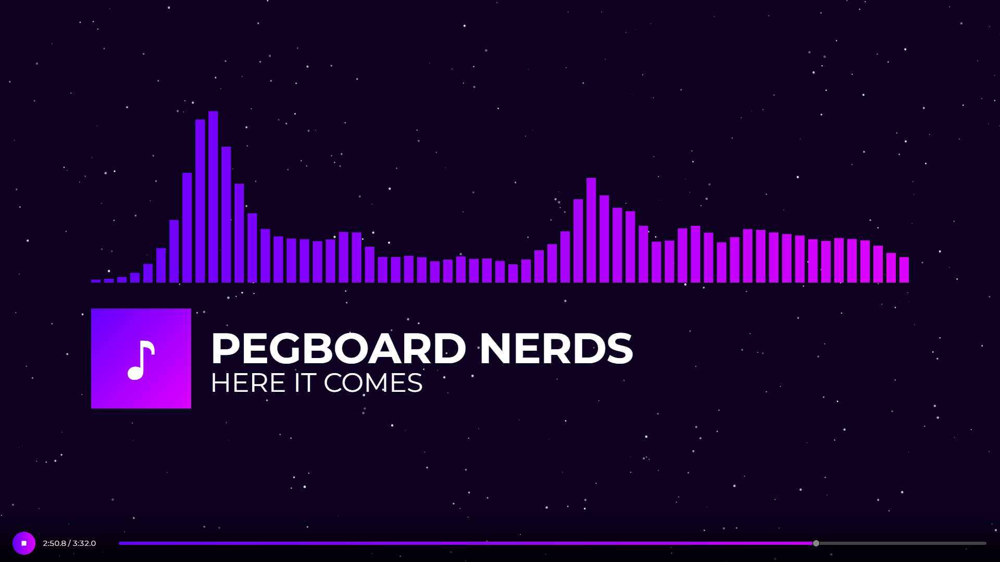
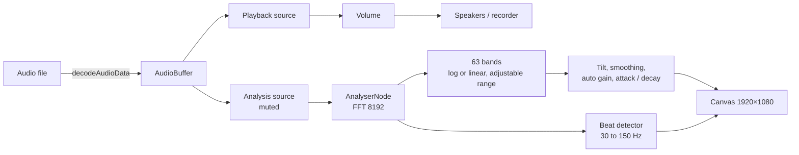

# Nebula Visualizer

[](https://nintobias.github.io/nebulaviz/)




Nebula Visualizer is a real-time music visualizer for the browser. It renders a spectrum, waveform or LED display from any audio file, with control over color, cover art, typography, backgrounds and effects. Screenshots and video (up to 3840 × 2160) are captured directly in the page.

Audio, images and video never leave your browser. The only external request is for web fonts, until they are self-hosted (see [Fonts](#fonts)).

## Features

- **Seven visualizer modes**: 63-band spectrum, circular, mirrored, smooth wave, mirrored wave, LED matrix and ridgeline, each with its own settings.
- **Configurable analysis**: 63 bands on a logarithmic or linear scale over an adjustable frequency range, with tone balance and response (smoothing, attack, decay, noise floor, contrast).
- **Beat-reactive**: bass-driven pulses for the cover and background, and beat-triggered star flashes and particle bursts.
- **Layered styling**: solid, gradient, rainbow and auto-cycling colors; a cover with shape, fit, border and shadow; text with font, weight, alignment, shadow and glow.
- **Backgrounds**: colors, gradients, still images, animated GIFs and videos. Videos and GIFs follow the song's playback state.
- **Playlists**: queue several tracks, play next, repeat, and reorder by drag and drop.
- **Live input**: visualize the audio of a shared browser tab, such as a YouTube or Spotify Web tab, without loading a file.
- **Presets and projects**: 14 built-in presets, custom presets, validated JSON import and export, randomize, and 100 steps of undo and redo.
- **Output**: PNG screenshots, and WebM or MP4 video at 720p to 4K, 24/30/60 fps, with selectable audio bitrate.
- **Layout**: a pinned preview, full-screen mode, and a responsive layout from desktop to mobile.

## Getting started

1. Open the [live demo](https://nintobias.github.io/nebulaviz/), or open `index.html` in a modern browser. No build step or server is required.
2. Choose one or more songs, or drop them on the page. Title, artist, album, year, track, genre and embedded cover art are read from ID3 tags (MP3) or FLAC tags when present.
3. Without a file, use **Play the built-in demo** under the player. The demo is synthesized in the browser.
4. Pick a visualizer mode and a preset as a starting point, then adjust.

## Live input

**Live input** visualizes audio from another source instead of a file. Click **Live input** and choose a browser tab in the browser's picker, ticking **Share tab audio**. The shared audio drives the visualizer. It is not played back through Nebula, so it keeps playing in its own tab.

- Requires a Chromium-based browser (Chrome or Edge) on desktop, served over HTTPS or from `localhost`. The button is disabled where tab audio cannot be captured.
- Every start goes through the browser's picker, so live input never starts in the background. Stop it with the button or with the browser's own "Stop sharing" control.
- While live input is on, the time display reads **Live input** and the transport is locked. Pressing Play or loading a song ends live input.
- Recording captures the live audio, the same as a song.
- Content the browser protects (DRM, for example) can arrive as silence. Streaming sites differ, so check the result in your own browser.

## Visualizer modes

| Mode | Description | Mode-specific settings |
| --- | --- | --- |
| 63-Bar Spectrum | Classic bars, one per band | Bar shape, corner size, spacing |
| Circular Spectrum | Bars radiating from a ring; bass at the top | Symmetry, radius, bar length, width, count |
| Mirrored Spectrum | Bars mirrored around a center line | Bar count (16–160), bar shape, spacing |
| Smooth Wave | One continuous curve with an optional fill | Line width, fill, line glow, detail |
| Mirrored Smooth Wave | The same curve above and below a center line | Line width, fill, line glow, detail |
| LED Matrix | Columns of round lights | Column count (16–100), falling peak dots |
| Ridgeline | Recent spectrum history stacked back to front | Rows, row spacing, peak height, line width |

Bar shapes are rectangle, rounded, capsule and beveled. Corner size applies to rounded and beveled bars.

**Show visualizer** (top of the Visualizer panel) hides the visualizer without touching the cover or text. The **Position** controls (Visualizer panel) move and resize the whole visualizer in any mode. **Offset X/Y** move it in pixels of the 1920 × 1080 frame: X runs from −400 to 400; Y runs from −200 (up) to +545 (down), an asymmetric range chosen so that every mode can reach the bottom edge. **Stretch** widens or narrows it sideways around the centre, from 50% to 125%; about 122% reaches both edges. Circular mode becomes an ellipse when stretched. The cover and text stay where they are, and presets keep your position and stretch.

## Frequency analysis

The **Frequency range** panel sets which part of the spectrum the bars show. A graph on a logarithmic axis (20 Hz to 20 kHz) displays the band positions and lights them with the music. Drag its two handles, or use the sliders, to set the lowest and highest frequency. The defaults are 20.9 Hz to 13.7 kHz.

- **Band spacing** moves from logarithmic (0%) to linear (100%). A linear scale gives the treble many more bars.
- **Tone balance** adds a treble boost that starts at a chosen frequency, caps its maximum, and cuts the low end.
- **Response** controls smoothing between neighbouring bars, the rise and fall speed, the noise floor, and contrast.

The bass pulse follows the lowest bars up to about 98 Hz, so it keeps working when the range changes. Beat detection always listens to 30–150 Hz.

## Appearance

- **Colors.** Main and gradient colors each have a hue wheel, a saturation and value square, and hex and RGB fields. Auto cycling rotates the hue. Rainbow spreads the spectrum across the bars or around the ring. **Lock overlay color** keeps the interface on the color you last chose while cycling.
- **Background.** Solid, two-color gradient (with a draggable angle dial; hold <kbd>Shift</kbd> for 15° steps or <kbd>Alt</kbd> to disable snapping), or a still image, GIF or video. Videos play muted and loop, and they are included in exports.
- **Cover.** Square, rounded, circle or squircle; crop or letterbox fit; size, offset and opacity; border; drop shadow. The offset ranges are wide enough to move the cover to every edge of the frame. Text can follow the cover's position and size. In circular mode the cover sits inside the ring, and the text stays centered beneath it.
- **Text.** **Show text** (top of the Text panel) hides the artist, title and extra info without touching the cover. Offsets are wide enough to move the text to every edge of the frame. Ten fonts, four weights, alignment, letter spacing, a shadow and an optional glow. Three lines are supported: artist, title and extra information.
- **Glow.** One blur radius with separate strengths for bars, cover and text. The glow follows the main color or the rainbow hue.
- **Stars and particles.** Density, speed, bass boost and color for the star field; beat sensitivity, amount and size for the bursts. One dial sets the direction of both.
- **Contrast protection.** If your colors are too close to the background, an outline in the opposite tone is added. Your chosen colors are never changed. Each part has its own **Contrast outline** checkbox: the visualizer (Visualizer panel), the placeholder cover (Cover panel) and the text (Text panel). Turning one off keeps your colors and skips only that outline.

## Playback and playlists

- Selecting several files creates a playlist. Choose **Add to queue** to append, or **Play next** to insert after the current track.
- **Previous** restarts the song after three seconds, or goes back on the first track. The <kbd>P</kbd> and <kbd>N</kbd> keys do the same as the buttons.
- **Play the next track automatically** and **Repeat the queue** are on the Playlist panel. Skipping while paused selects the track without starting it.
- Drag a track by its ⋮⋮ handle to reorder the queue, or focus the handle and use the arrow keys.
- The title and artist you type are kept for that track: repeating it or coming back to it keeps your text, while other tracks show their own tags.
- Only the playing track is decoded and held in memory, so long playlists use no more memory than a single song.
- Stars, particles, videos and GIFs stop while a loaded song is paused, so a recording resumes exactly where it stopped.
- Click the time display to switch between elapsed and remaining time. The choice is remembered.

## Presets, projects and history

- **Preset gallery.** Each preset is drawn from its real colors, mode, glow and stars.
- **Built-in presets (14)** cover classic, neon, cinematic, minimal and club looks, plus LED and mirrored-wave variants.
- **Custom presets.** Save the current look under a name. Presets never change the text, cover or frequency range.
- **JSON projects.** Export and import all settings. Audio and images are not included. Imports are validated: unknown or invalid fields are skipped and values are clamped to each control's range.
- **Randomize** applies a random look. It can run automatically when a new song loads.
- **Reset to defaults** asks for confirmation and keeps your song, images and text.
- **Undo and redo** cover settings, images and custom presets, up to 100 steps. A slider drag is one step.

## Export

- **Screenshot:** the camera button saves the current frame as a PNG.
- **Video:** the record button captures the canvas and the song's audio.

| Setting | Options |
| --- | --- |
| Format | WebM (VP9, VP8 or browser default), MP4 where supported |
| Resolution | 1280 × 720 (downscaled), 1920 × 1080 (native), 2560 × 1440 and 3840 × 2160 (upscaled) |
| Frame rate | 24, 30 or 60 fps |
| Audio bitrate | 128, 192, 256 or 320 kbps |

The picture is always rendered at 1920 × 1080 and scaled to the chosen size. Recording runs in real time, so keep the tab visible. A warning appears if the browser drops frames. Pausing the song pauses the recording.

## Keyboard and drag & drop

| Input | Action |
| --- | --- |
| <kbd>Space</kbd> | Play / pause |
| <kbd>N</kbd> / <kbd>P</kbd> | Next / previous track |
| <kbd>M</kbd> | Mute / unmute |
| <kbd>F</kbd> | Full screen (<kbd>Esc</kbd> leaves the fallback mode) |
| <kbd>Ctrl</kbd> / <kbd>⌘</kbd> + <kbd>Z</kbd> | Undo |
| <kbd>Ctrl</kbd> / <kbd>⌘</kbd> + <kbd>Y</kbd>, or <kbd>Shift</kbd> + <kbd>Z</kbd> | Redo |

Drop targets:

- **Audio** becomes the song, or joins the playlist when dropped on the Playlist panel.
- **Image** dropped on the cover spot or the Cover panel sets the cover. A dashed outline shows the cover spot while you drag.
- **Image, GIF or video** dropped anywhere else sets the background. Videos are always backgrounds.
- **`.json`** imports a project.

## Architecture



- Band energies are tilt-corrected, smoothed and normalized by an automatic gain, so quiet and loud material both fill the display.
- A beat is a rise in 30–150 Hz energy relative to its own recent average. It drives star flashes, particle bursts and the bass pulse.
- Everything is drawn to one 1920 × 1080 canvas, which is what screenshots and recordings capture.
- Animated GIFs are decoded in the page and stepped on the visualizer's clock, so they behave the same in every browser.

## Browser support and limits

- **Audio** is decoded by the browser. MP3, WAV, OGG, FLAC, M4A and AAC normally work. Tags are read from MP3 and any file with ID3v1 or ID3v2 tags, and from FLAC (Vorbis comments and cover art). Ogg and M4A tags are not read yet.
- **Length.** Decoded audio is held in memory at roughly 10–20 times the file's size. Tracks that would exceed the browser's memory allowance are refused with a message instead of crashing the tab. In practice that is roughly an hour of stereo audio.
- **Live input** depends on the browser's screen-capture support, which is strongest in Chromium on desktop. Other browsers may offer no audio.
- **Images** are limited to 25 MB. Large images are downscaled to the size that can be drawn.
- **Video backgrounds** are limited to 1 GB. Playback depends on the codecs your browser supports; MP4 (H.264) and WebM are the safest choices.
- **GIFs** are limited to 25 MB, and their decoded frames to 600 MB. Very large GIFs are refused.
- **Recording** requires `MediaRecorder` and canvas capture. Only the formats your browser can record are offered.
- **Older browsers** fall back gracefully: rounded cover corners become square without `roundRect`, and the settings layout uses a simpler grid without CSS subgrid.

Tested in headless Chromium. Firefox and Safari are not yet verified.

## Development

| Path | Purpose |
| --- | --- |
| `index.html` | Interface and controls |
| `style.css` | Layout, theming and styling |
| `script.js` | Audio analysis, rendering, presets, playlists, history, import and export |
| `queue.js` | Playlist order logic: next, previous, insert, remove, move |
| `id3.js` | ID3 tag reader (v1, v2.2, v2.3, v2.4, cover art) |
| `demo.js` | Synthesizer for the built-in demo track |
| `gif.js` | Animated GIF decoder (frames, disposal, transparency, interlacing) |
| `tests/` | Node tests for the ID3 reader, the GIF decoder, the demo synthesizer, the playlist logic and the font tool |
| `tools/get-fonts.mjs` | Downloads the web fonts into `fonts/` |

Run the tests with `npm test` (Node 20 or later; nothing to install). The GIF tests use small hand-built fixtures that exercise each frame rule, and the ID3 tests cover unsynchronised, compressed and extended-header tags.

**Design notes.** The parsing and playlist logic live in plain scripts with no dependencies, so they can be tested in Node. They are not ES modules, because modules cannot load from `file://`, and opening `index.html` locally is supported. The rendering, settings and history code depends on the browser's audio and canvas APIs, so it is kept together in `script.js` for now.

### Fonts

Text can use ten font families. Until the fonts are self-hosted, the page loads the Google Fonts it needs, which is the only request that leaves the browser. To self-host them:

```
npm run fonts
```

Then commit the generated `fonts/` folder. The page prefers `fonts/fonts.css` and falls back to Google Fonts only when that file is missing.

## License and disclaimer

Nebula Visualizer is an independent project inspired by the spectrum aesthetic of Monstercat's early visuals. It is not affiliated with or endorsed by Monstercat.