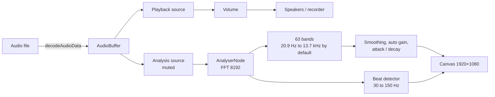

# Nebula Visualizer

A real-time audio visualizer inspired by Monstercat's classic spectrum aesthetic. Load a song, add cover art and track details, and watch the visualizer react to the beat, bass and melody.

[](https://nintobias.github.io/nebulaviz/)


> [!NOTE]
> Your audio and images are processed entirely in your browser. Nothing is uploaded anywhere. Web fonts are the one outside request: run `npm run fonts` once to self-host them (see [Fonts](#fonts-and-privacy)).

## Contents

- [Nebula Visualizer](#nebula-visualizer)
  - [Contents](#contents)
  - [Overview](#overview)
  - [Quick start](#quick-start)
  - [Visualizer modes](#visualizer-modes)
  - [Settings reference](#settings-reference)
  - [Presets, projects and history](#presets-projects-and-history)
    - [Song tags (ID3)](#song-tags-id3)
  - [Playlists](#playlists)
  - [Output: screenshots and video](#output-screenshots-and-video)
  - [Shortcuts and drag \& drop](#shortcuts-and-drag--drop)
  - [How it works](#how-it-works)
  - [Browser support and limits](#browser-support-and-limits)
  - [Project structure](#project-structure)
    - [Fonts and privacy](#fonts-and-privacy)
    - [Why `script.js` is still one file](#why-scriptjs-is-still-one-file)
  - [Notes](#notes)

## Overview

Nebula Visualizer is a browser-based music visualizer built with the Web Audio API and Canvas. It started as a classic 63-bar spectrum inspired by early Monstercat visuals and has grown into a "visualizer studio": seven display modes, full control over colors, cover art, text and effects, ten built-in presets, undo/redo, project import/export, and screenshot and video capture.

**Highlights**

- Seven visualizer modes, from the classic bars to a ridgeline plot, each with its own controls
- A built-in demo track (**Try demo**), so you can see it move before choosing a song
- A visual preset gallery, and an **Essentials / All settings** switch that keeps the panel list short for newcomers
- Audio-reactive motion with adjustable sensitivity, bass-driven cover and background pulses, and beat-triggered stars and particles
- Colors: main color, gradient, rainbow, auto color cycling, background color/gradient/image
- An adjustable frequency range with a draggable graph, plus advanced tone and response controls
- A styleable cover (shape, size, position, border, shadow, opacity) and fully styleable text (font, weight, alignment, shadow)
- Glow effects, a star field and particle bursts, with direction control
- Playlists: choose several songs, queue more or play one next, and move through them with Previous and Next
- Presets, JSON projects, randomize, reset, and 100-step undo/redo
- PNG screenshots and WebM/MP4 video export up to 4K
- Full-screen mode, a hideable play bar, and a responsive layout for desktop and mobile. The preview stays pinned while you scroll through the settings

## Quick start

1. Open the live demo, or open `index.html` locally in a browser. No build step or server is needed.
2. Click **Choose song** and pick an audio file (see [limits](#browser-support-and-limits)). Artist, title and embedded cover art are filled in automatically when the file has [ID3 tags](#song-tags-id3).
3. No song at hand? Press **Try demo** to play a built-in tune. Optionally choose a different cover image and edit the **Artist**, **Song title** and **Extra info** fields.
4. Press play (<kbd>Space</kbd>) and choose a mode in the **Visualizer** panel.
5. Tweak colors, cover, text, glow and stars to match the track.
6. Save a preset, export a project, or capture a screenshot or video.

## Visualizer modes

| Mode | Description | Mode-specific controls |
| --- | --- | --- |
| **63-Bar Spectrum** | Classic FFT bars, the original Nebula look | Bar shape, corner size, spacing |
| **Circular Spectrum** | Bars radiating around a ring, bass at the top | Symmetry, radius, bar length, width, count |
| **Mirrored Spectrum** | Symmetrical bars around a center line | Bar count (16–160), bar shape, spacing |
| **Smooth Wave** | One continuous flowing curve with a soft fill | Line width, fill, line glow, detail |
| **Mirrored Smooth Wave** | The same curve above and below a center line | Line width, fill, line glow, detail |
| **LED Matrix** | Columns of round lights | Column count (16–100), falling peak dots (gravity) |
| **Ridgeline** | Recent spectrum history stacked back to front | Rows, row spacing, peak height, line width; only the front line glows |

Bar shapes are **Rectangle**, **Rounded**, **Capsule** and **Beveled**. Corner size applies to Rounded and Beveled.

## Settings reference

Settings are grouped in collapsible panels. **Essentials** (the default for first-time visitors) hides the technical panels, Frequency range and Stars & Particles; **All settings** shows everything, and your choice is remembered. Every slider also has a numeric box where you can type an exact value, and hovering a slider explains what the number means.

<details>
<summary><strong>Sound & Reactivity</strong></summary>

| Control | What it does |
| --- | --- |
| Sensitivity | Bar height gain, 40–160%. 100% matches the original reference look. |
| Pulse cover artwork to bass | Makes the cover grow on bass hits; **Cover pulse** sets the amount (up to 40%). |
| Pulse background to bass | Adds a wash of the main color on bass; **BG pulse** sets the strength. |

</details>

<details>
<summary><strong>Frequency range</strong></summary>

Chooses which part of the sound spectrum the 63 bars show. A graph on a logarithmic frequency axis (20 Hz to 20 kHz) displays the bar positions, lights them up with the music, and has two handles you can drag. The sliders below it stay in sync with the handles.

| Control | What it does |
| --- | --- |
| Lowest / Highest | First and last frequency shown (20–500 Hz and 1–20 kHz). The default is 20.9 Hz to 13.7 kHz. |
| Band spacing | 0% = logarithmic (default), 100% = linear, which gives the treble many more bars. |
| Reset range | Restores every frequency setting, including the advanced ones. |

**Advanced options** (collapsed by default):

| Group | Controls |
| --- | --- |
| Tone balance | Treble boost (dB per octave), the frequency it starts from, its maximum, and the low-end cut |
| Response | Smoothing between neighbouring bars, rise speed, fall speed, noise floor, contrast |

> [!NOTE]
> The bass pulse (cover, background and star boost) follows the lowest bars up to about 98 Hz, at least three, so it still works when you move the range. Beat detection always listens to 30–150 Hz.

</details>

<details>
<summary><strong>Colors</strong></summary>

- **Main color** and optional **Gradient** end color, each with a hue wheel, saturation/value square, hex and RGB fields.
- **Auto color cycling** slowly rotates the hue (1–90°/s).
- **Rainbow** paints the whole spectrum across the bars, or around the ring in circular mode. Optionally moving, with direction and speed (10–360°/s).
- **Overlay colors** tints the play bar, sliders and checkboxes with your colors. **Lock overlay color** keeps the interface on the color you last picked, so cycling and rainbow don't keep recoloring it.

</details>

<details>
<summary><strong>Background</strong></summary>

- A solid color, a two-color gradient with a draggable angle dial, or a background image.
- Dial: drag to set the angle. <kbd>Shift</kbd> snaps to 15° steps, <kbd>Alt</kbd> disables snapping.
- An image covers the color and gradient settings, which are dimmed while one is loaded.

</details>

<details>
<summary><strong>Glow</strong></summary>

A shared **Blur radius** plus separate strengths for **Bars**, **Cover art** and **Text**. The glow uses your main color (or the live rainbow hue). 0% turns a glow off. In the Ridgeline only the front line glows, because a glow on every row would be too heavy to draw.

</details>

<details open>
<summary><strong>Cover</strong></summary>

| Control | What it does |
| --- | --- |
| Show cover | When off, the text slides left into the free space instead of leaving a gap. |
| Shape | Square, rounded square, circle or squircle. |
| Corner radius | For the rounded square only, as a percentage of the cover size. |
| Size | 50–150%. 100% is the original 192 px. |
| Offset X / Y | Moves the cover, in pixels of the 1920×1080 frame. |
| Opacity | 0–100%. Useful over busy background images. |
| Fit | **Crop to fill** (default) or **Fit**, which shows the whole image with black letterbox bars. |
| Attach text to cover | On by default. The text follows the cover's size and position; off keeps the text where it is. |
| Border | Width, color, or **Match visualizer color** (gradient or rainbow). Drawn inside the cover's edge. |
| Shadow | Opacity, blur, offset X/Y and color. Opacity 0% means no shadow. |
| Placeholder | With no image, the placeholder follows the chosen shape. The ♪ can be hidden or recolored. |

> [!TIP]
> In circular mode the cover sits inside the ring. Size and Offset are relative to that spot, and the text stays centered under the ring, so **Attach text to cover** has no effect there.

</details>

<details>
<summary><strong>Text</strong></summary>

- **Font:** Montserrat (original), Oswald, Bebas Neue, Playfair Display, Orbitron, Pacifico, Arial, Georgia, Courier New or Impact. Web fonts are fetched from Google Fonts when first selected.
- **Weight:** Default (bold artist over regular title), Regular, Bold or Heavy.
- **Align:** Auto (left of the cover, or centered under the ring), Left, Center or Right.
- **Size** 50–150%, **letter spacing**, **Offset X/Y**, **text color**, or **Match visualizer colors**.
- **Shadow:** opacity, blur, offset X/Y and color.
- Three lines are supported: artist, title and optional extra info. Long lines shrink to fit.

</details>

<details>
<summary><strong>Stars & Particles</strong></summary>

| Group | Controls |
| --- | --- |
| Stars | Density (20–1200), speed, bass boost, light up on beat with intensity, color (white, main, gradient or rainbow) |
| Particle bursts | Beat sensitivity, amount per beat (5–300), size, speed |
| Direction | One dial sets the direction stars fly and particles drift |

Stars and particles freeze while a loaded song is paused, so a recording resumes exactly where it left off.

</details>

<details>
<summary><strong>Contrast protection</strong></summary>

When your colors are too close to the background, an outline in the opposite tone is added around bars, the cover placeholder and text, and a two-tone outline is used over mixed backgrounds. Your chosen colors are never changed.

</details>

## Presets, projects and history

- **Preset gallery:** every preset, built-in or your own, is a small card drawn from its colors and mode. Click one to apply it.
- **Built-in presets (10):** Default Nebula, Cyberpunk Neon, Sunset Vibes, Minimal Mono, Cinematic, Neon Ring, Chillwave, Synthwave, Clean Minimal and Dark Club.
- **Custom presets:** **Save Current as Preset** stores the current look. Built-in names are protected, and replacing an existing preset asks first.
- **Export / Import JSON:** saves and loads every setting, including text, cover and frequency range. Audio and images are not included. Imports are validated: invalid fields are skipped with a message, and numbers are clamped to each control's real range.
- **Randomize:** applies a random color and layout look. **Randomize look when a new song loads** does it automatically.
- **Reset to defaults:** asks for confirmation and keeps your song, images and text content.
- **Undo / Redo:** up to 100 steps covering settings, images and custom presets. Dragging a slider counts as one step, and auto color cycling never adds steps.

> [!NOTE]
> Presets leave the text, cover and frequency range alone, so switching looks never changes your layout. Reset to defaults does restore them.

### Song tags (ID3)

When you load an MP3 (or any file with ID3v1 or ID3v2.2 / 2.3 / 2.4 tags), Nebula reads the tags locally in your browser:

- **Title** and **Artist** fill the text fields. Without a title tag the file name is used, as before.
- **Album, year, track number and genre** appear in the info line under the song controls.
- **Embedded cover art** (the front cover when there are several) becomes the cover.
- Your own choices win: a cover you picked yourself is never replaced, and an artist you typed over is kept. Tag-filled values are replaced when you load the next song.
- Filling the fields is one undo step. Other formats (FLAC, Ogg, M4A) play fine but their tags are not read yet.

## Playlists

Choose several songs at once with **Choose song** (or drop them on the page) and they become the playlist, played in order. The **Playlist** panel shows the queue; click a track to play it, or <kbd>✕</kbd> to remove it.

- **Previous / Next** buttons beside the play button, or the <kbd>P</kbd> and <kbd>N</kbd> keys. Previous restarts the song if it has played for more than 3 seconds or is on the first track.
- **Add to queue** appends songs to the end. **Play next** inserts them right after the playing track.
- **Play the next track automatically** (on by default) starts the following track when one ends. **Repeat the queue** wraps back to the first track after the last one.
- Skipping while paused selects the track without playing it.
- Only the playing track is decoded and held in memory, so a long playlist uses no more memory than a single song. Each track has the same length limit as a single song.
- Each new track updates the artist, title and cover from its ID3 tags, as for a single song. A cover or artist you typed yourself is kept.
- Video recording ends when a track ends or changes; start a new recording for the next track.
- The queue is not part of undo/redo, and it is not saved in project files (JSON projects hold settings only).
- The demo track is not part of the playlist.

## Output: screenshots and video

**Screenshot:** the camera button saves the current frame as a PNG.

**Video export:** the record button on the player captures video and audio.

| Option | Choices |
| --- | --- |
| Format | Whatever your browser can record: WebM (VP9, VP8, AV1 or default) and MP4 (H.264 or default) |
| Resolution | 1280×720 (downscaled), 1920×1080 (native), 2560×1440 and 3840×2160 (upscaled) |
| Frame rate | 24, 30 or 60 fps |
| Audio bitrate | 128, 192, 256 or 320 kbps |

- The picture is always drawn at 1920×1080 and scaled, so higher resolutions are an upscale.
- Recording runs in real time, so keep the tab visible: browsers throttle background tabs and the video can drop frames. A warning appears if that happens.
- Pausing the song pauses the recording. It stops and saves when you click the button again or the song ends.
- The export follows the volume slider and mute, and survives seeking.
- Video and screenshots match the on-screen result.

## Shortcuts and drag & drop

| Key | Action |
| --- | --- |
| <kbd>Space</kbd> | Play / pause |
| <kbd>M</kbd> | Mute / unmute |
| <kbd>N</kbd> / <kbd>P</kbd> | Next / previous track in the playlist |
| <kbd>F</kbd> | Full screen (<kbd>Esc</kbd> exits the fallback full-screen mode) |
| <kbd>Ctrl</kbd>/<kbd>⌘</kbd> + <kbd>Z</kbd> | Undo |
| <kbd>Ctrl</kbd>/<kbd>⌘</kbd> + <kbd>Y</kbd> or <kbd>Shift</kbd> + <kbd>Z</kbd> | Redo |

**Drag & drop** anywhere on the page: audio files load as the song, images become the cover (or the background if dropped on the Background panel), and `.json` files import as a project.

## How it works



- The spectrum is split into 63 bands (logarithmic by default, range adjustable), tilt-corrected, smoothed, and normalized by an automatic gain so quiet and loud songs both look good.
- A beat is a jump in 30–150 Hz energy relative to its own recent average. It drives star flashes, particle bursts and the bass pulse.
- Everything is drawn to a single 1920×1080 canvas, which is also what screenshots and recordings capture.

## Browser support and limits

- **Audio:** decoded by your browser, so supported formats vary (MP3, WAV, OGG, FLAC, M4A, AAC and others typically work).
- **Long files:** a song is decoded into memory in full (about 10 to 20 times the size of an MP3). Files estimated to need more than about 0.8 GB (less on small devices) are refused with a message instead of crashing the tab. In practice that means roughly an hour of stereo audio at most.
- **Images:** up to 25 MB each. Large images are downscaled to the size that can actually be drawn.
- **Video export:** needs `MediaRecorder` and canvas capture. Only formats your browser supports are listed.
- **Older browsers:** rounded cover corners fall back to square without `roundRect`, and the settings layout falls back to a simpler grid without CSS subgrid.

## Project structure

| File | Purpose |
| --- | --- |
| `index.html` | Application UI and controls |
| `id3.js` | ID3 tag reader (v1, v2.2, v2.3, v2.4, cover art). A plain script with no dependencies |
| `demo.js` | Synthesizer for the built-in demo track. A plain script with no dependencies |
| `style.css` | Layout, theming and visual styling |
| `queue.js` | Playlist order logic (next, previous, insert, remove). A plain script with no dependencies |
| `script.js` | Audio analysis, rendering, presets, export/import, playlist and visualizer behavior |
| `tests/` | Node tests for the ID3 reader, the demo synth, the playlist logic and the font tool. Run `npm test` (Node 20+; nothing to install) |
| `tools/get-fonts.mjs` | Downloads the web fonts into `fonts/` for self-hosting (`npm run fonts`) |
| `fonts/` | Created by the font tool; not in the repository until you run it |

**Built with:** vanilla JavaScript, the Web Audio API (`AnalyserNode` and audio buffers), and HTML Canvas 2D. No framework or build step.

### Fonts and privacy

The text options use a few Google fonts. Until you run the font tool, the page loads them from Google Fonts, which is the one request that leaves your browser. To self-host them:

```
npm run fonts      # or: node tools/get-fonts.mjs  (needs Node 18+ and internet, once)
```

then commit the generated `fonts/` folder. The page loads `fonts/fonts.css` first and only falls back to Google when that file is missing.

### Why `script.js` is still one file

The pure, testable parts live in their own plain scripts (`id3.js`, `demo.js`), loaded in order before `script.js`. They are ordinary scripts rather than ES modules on purpose: modules cannot be loaded from `file://`, and "open `index.html` locally" is a feature. The rendering, settings and history code is tightly interwoven and needs a browser to test, so it stays together for now.

## Notes

This is a fan-made tribute project and is not affiliated with Monstercat.